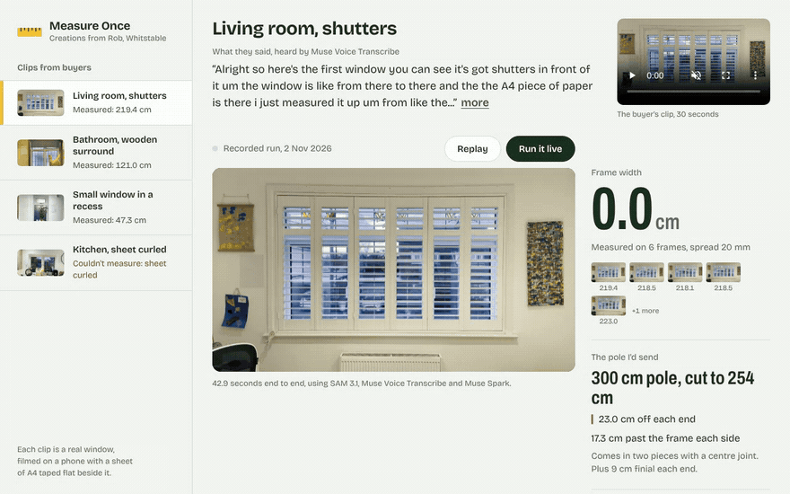

<p align="center"></p>

<h1 align="center">Measure Once</h1>

<p align="center"><b>Made-to-measure without the tape measure: film your window, get the right size first time.</b></p>

<p align="center"><a href="https://measure-once.vercel.app">Try it</a> · <a href="https://www.youtube.com/watch?v=TBD">3-minute video</a> · <a href="#run-it-yourself">Run it yourself</a> · <a href="#measured-against-a-tape">Measured against a tape</a></p>

I make reclaimed-wood curtain poles in Whitstable and sell them on Etsy. Poles come in fixed lengths, buyers cut them down at home, and a cut pole can't come back. So about 1 in 4 of my buyer conversations are someone asking which size to order. I read the last 125 buyer threads in my inbox: 29 were sizing questions, my replies ran to 77 words on a normal day and 263 on a hard one, and buyers waited 10 hours for an answer.

Big blind retailers sell insurance against this: mismeasure cover at £19.95 or $9.99 a blind, and the big ones leave curtains and curtain hardware out of it. A one-person shop has no cover at all.

Measure Once is the sizing desk I wanted. The buyer films their window for ten seconds with a sheet of A4 taped flat on the wall and says what they want. Meta's models find the sheet, the window and the buyer's hands, my code turns that into millimetres, my catalogue rules pick the pole and the cut, and Muse Spark drafts my reply in my words. I check it and press send.

## Try it

| Try this | What happens |
|---|---|
| Open [the inbox](https://measure-once.vercel.app) and pick **Living room, shutters** | My real window, measured from my own clip: the sheet is found, a tape snaps across the frame, the photo flattens into a scale drawing with the pole and the cut marked |
| Press **Run it live** | The whole pipeline runs again on that clip, on Meta's models, in about 29 seconds |
| Press **Show the pole on this window** | Muse Image paints the recommended pole; SAM 3.1 cuts out just the pole and it's pasted onto the untouched photo |
| Pick **Kitchen, sheet curled** | The tool refuses to measure and tells the buyer how to re-film, instead of guessing |

## What it does for one buyer

1. **The buyer films the window** with an A4 sheet taped flat on the wall beside it, and talks: "eyelet curtains, I want them to clear the glass, from about here to here."
2. **SAM 3.1** segments the sheet and the window on the sharpest frames, and tracks the buyer's hands through the whole clip in one video call.
3. **My code works out millimetres.** The sheet's known 210 by 297 mm fixes the scale and the window's straight edges fix the angle of the wall. The model never produces a number.
4. **Muse Voice Transcribe** hears the request, with curtain words given as keywords.
5. **My catalogue rules** pick the pole: 15 to 20 cm past the frame each side, the shortest stock length that works, the cut taken equally off each end so the join stays central.
6. **Muse Spark** drafts my reply in my voice, using only the numbers the code produced. A checker rejects any draft with a number the code didn't compute.
7. **Muse Image** paints the pole on the buyer's own window. **SAM 3.1** cuts out the painted pole, and only the pole is pasted back, so nothing else in their photo changes.
8. **I approve and send.** The buyer gets the size and the exact cut, and can order the right length first time.

For my living room window it recommends the **300 cm pole cut to 251 cm**, taking **24.5 cm off each end**.

## Measured against a tape

Three of my own windows, measured with a tape before the tool ran, and three clips filmed to fail. No tuning on these after the answer key was written.

| Window | Tape | Measure Once | Difference |
|---|---|---|---|
| Bathroom, wooden surround | 119.0 cm | 119.5 cm | 5 mm |
| Living room, shutters | 222.0 cm | 215.7 cm | -63 mm |
| Small window in a recess | 59.0 cm | 46.2 cm | -128 mm |

The clips filmed to fail (no sheet, a curled sheet, a steep angle): refused 3 of 3, each with the right reason.

A pole doesn't need tape-measure precision, because it runs 15 to 20 cm past the frame either side; an error of a few centimetres moves the overhang, not the order. The small recessed window is the honest miss: the tool measured the white recess where it meets the wall, and I measured a different pair of edges. The drawing shows the buyer and me exactly which edges were measured, so a mismatch like that is caught before anything is cut.

## How Meta's models are used

| # | Model | The job it does | Code |
|---|---|---|---|
| 1 | SAM 3.1 (image) | Finds the A4 sheet and three readings of the window (frame, surround, wooden frame) on each sharp frame | `src/measure.ts` |
| 2 | SAM 3.1 (video tracking) | Tracks the buyer's hands through the clip in one call, so hand-covered frames are set aside and the "from here to here" span is read | `src/pipeline.ts` |
| 3 | Muse Voice Transcribe | Hears the buyer's request, keyword-biased for curtain terms | `src/pipeline.ts` |
| 4 | Muse Spark 1.3 | Picks among the computed options for what the buyer said and drafts my reply | `src/agent.ts` |
| 5 | Muse Image | Paints a photoreal pole where the code placed it | `src/render.ts` |
| 6 | SAM 3.1 (image) | Cuts the painted pole out, so only the pole lands on the buyer's photo | `src/render.ts` |

Take any one away and something breaks: without SAM there's nothing to measure, without the edges of the sheet there's no scale, without Spark the buyer's words don't change the answer, without the second SAM pass the painted room would replace theirs.

## What's live and what's recorded

- The inbox opens on recorded runs of my own clips, so the first screen is never empty. **Run it live** re-runs the whole pipeline on Meta's API.
- Live runs, renders and sends are capped per day. The recorded runs are the same code.
- Approved replies go by email to a demo inbox I own; the page never asks a visitor for an email address.

## Run it yourself

Needs Node 20.17 or later, ffmpeg, and a Meta Model API key.

```bash
git clone https://github.com/iamrobertmoore/measure-once && cd measure-once
npm install
export MODEL_API_KEY=your_key
npm start                                   # the inbox at http://localhost:3000, with live runs
npm run measure -- samples/bathroom/source.mp4  # one clip from the command line
npm test                                    # the geometry checks
```

## Challenges I hit, and the fixes

- **A small sheet can't be trusted to set the wall's angle.** At A4 size, one pixel of error at a corner is 1% of the scale. The fix fits the sheet and the whole window together: the sheet sets the scale, the big window sets the angle (`jointFitEdges` in `src/geometry.ts`).
- **Masks are a few pixels fat or thin, and that's a 3 cm error.** On simulated frames, a 2 to 3 pixel mask bias gave 30 to 38 mm of error, and averaging frames didn't remove it. Each side is now re-found on the photo itself: SAM finds the object, the pixels measure it (0.1 to 0.2 mm on the same simulated frames).
- **A white sheet on a cream wall is nearly invisible in grey.** Edges are found on the colour axis that best separates the sheet from its own wall (`contrastMap` in `src/measure.ts`).
- **Real windows hide their bottom edge** behind plants and bottles, or run out of shot. A pole only needs the width, so the fit now works from the top and both sides, or from the sides alone.
- **SAM sees several "windows" in one window.** The frame, the trim and a wooden surround all come back. The pole has to clear the outermost one, so every frame is measured against each reading and the widest one that holds across frames wins.
- **Rate limits.** Ten frames times five prompts at once hit the limit. SAM calls now share a small queue with backoff, and the hands moved to a single video call.
- **Muse Image moves things.** The painted pole drifted from where the code placed it, so only the part of SAM's pole mask inside the planned region is kept, and the exact drawn pole is the fallback.

## Built for the Meta Global AI Developer Hackathon

Everything here was written during the event (26 October to 4 November 2026). The clips are of my own house. MIT licence.
