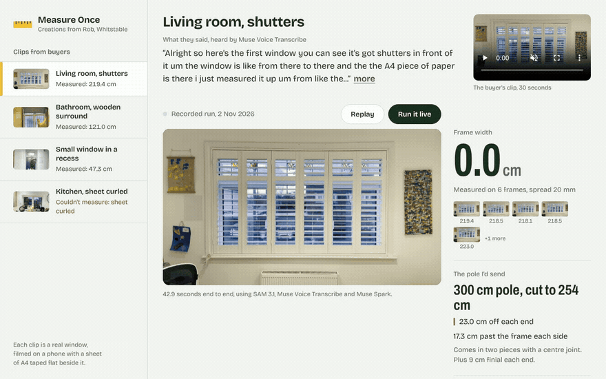
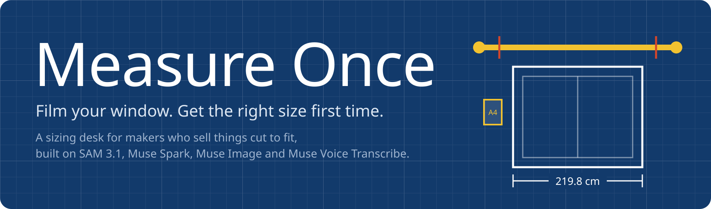
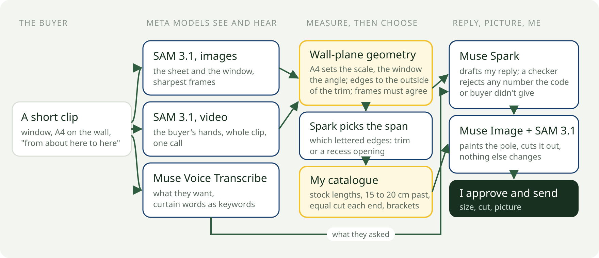

<p align="center"></p>

<p align="center"></p>

<p align="center"><b>A sizing desk for people who make things to measure. The buyer films their window; I get the size, the cut and a drafted reply to approve.</b></p>

<p align="center"><a href="{{live_url}}"><b>Try it live</b></a> · <a href="{{video_url}}">3-minute video</a> · <a href="#measured-against-a-tape">Measured against a tape</a> · <a href="#run-it-yourself">Run it yourself</a></p>

I make reclaimed-wood curtain poles in Whitstable and sell them on Etsy. Poles come in fixed lengths, the buyer cuts theirs down at home, and a cut pole can't come back. So a lot of my day is people asking which size to order, and every answer starts with "could you measure from here to here".

Measure Once is the desk I wanted for that. The buyer films their window for a few seconds with a sheet of A4 taped flat on the wall and says what they want. SAM 3.1 finds the sheet, the window and their hands. My code turns pixels into millimetres. My catalogue rules pick the pole and the cut. Muse Spark drafts my reply in my words, Muse Image shows the pole on their own wall, and I check it and press send.

It's built around my shop, but the same desk works for anyone selling blinds, shutters, curtains or anything else cut to fit a window.

## Try it

No login, nothing to install. The page opens on my own living room window.

| Try this | What happens |
|---|---|
| Open [the inbox]({{live_url}}) and pick **Living room, shutters** | The sheet is found, a tape snaps across the frame, and the photo flattens into a scale drawing with the pole, the cut and where the buyer pointed |
| Press **Run it live** | The whole pipeline runs again on that clip, on Meta's models, in about {{run_seconds}} seconds |
| Press **Show the pole on this window** | Muse Image paints the pole; SAM 3.1 cuts out only the pole and it's pasted onto the untouched photo |
| Pick **Small window in a recess** | The buyer said 59 cm and the tool measured {{sm_measured_cm}} cm. The reply says both, sizes both, and asks which edges they meant |
| Pick **Kitchen, sheet curled** | It refuses to measure and tells the buyer how to film it again, instead of guessing |

## The problem, in my own inbox

I read my last {{inbox_threads_read}} buyer threads. {{inbox_sizing_threads}} were about which size to order, about {{inbox_sizing_share}} of everything. My replies ran to {{inbox_reply_words_median}} words on a normal day and {{inbox_reply_words_p90}} on a hard one, and buyers waited a median {{inbox_wait_hours_median}} hours for an answer. Big blind retailers sell mismeasure cover at {{cover_price_uk}} or {{cover_price_us}} a blind. A one-person shop has nothing like that, so the size has to be right first time.

## Check every claim in five minutes

| Claim | Evidence | How to check |
|---|---|---|
| It measures real windows to within {{within_cm}} cm | Two of my windows: {{lr_err_mm}} mm and {{bt_err_mm}} mm against a tape | [Measured against a tape](#measured-against-a-tape), or the link at the foot of the live page |
| The model never makes up a number | Every number in a draft must come from the code or the buyer's own words, or the draft is rejected | {{ref_check}} |
| It knows when not to answer | 3 clips filmed to fail (no sheet, curled sheet, steep angle): refused {{refused}} of {{refusals}} | Pick **Kitchen, sheet curled** on the live page |
| Nothing in the buyer's photo changes except the pole | Only SAM's cut-out of the painted pole is pasted back onto the original | {{ref_sam_pole}} |
| It runs live, not just recorded | **Run it live** calls the same pipeline on Meta's API | Press it; the label changes to "Live run, just now" |

## What happens to one clip

<p align="center"></p>

1. **The buyer films the window** with the sheet on the wall, and talks: "eyelet curtains, from about here to here."
2. **SAM 3.1** segments the sheet and the window on the sharpest frames, and tracks the buyer's hands through the whole clip in one video call.
3. **My code works out millimetres.** The sheet's known 210 by 297 mm fixes the scale and the window's straight edges fix the angle of the wall. The window is measured to the outside of its trim, where a tape would go.
4. **Muse Voice Transcribe** hears the request, with curtain words passed as keywords.
5. **My catalogue rules** pick the pole: 15 to 20 cm past the frame each side, the shortest stock length that works, the cut taken equally off each end so the join stays central.
6. **Muse Spark** drafts my reply in my voice from those numbers. If the buyer said a length that disagrees with ours, the reply puts both side by side and asks.
7. **Muse Image** paints the pole on their window, and **SAM 3.1** cuts the painted pole back out, so only the pole is added.
8. **I approve and send.**

For my living room window it recommends the **{{lr_pole}}**, taking **{{lr_cut_each_end_cm}} cm off each end**.

## How Meta's models are used

Six distinct jobs, each one load-bearing.

| # | Model | The job | Code |
|---|---|---|---|
| 1 | SAM 3.1, images | Finds the A4 sheet and three readings of the window (frame, surround, wooden frame) on each sharp frame | {{ref_sam_image}} |
| 2 | SAM 3.1, video | Tracks the buyer's hands through the whole clip in one call: where they pointed, and which frames to set aside | {{ref_sam_video}} |
| 3 | Muse Voice Transcribe | Hears what the buyer wants, biased to English with curtain words as keywords | {{ref_voice}} |
| 4 | Muse Spark 1.3 | Picks among the options the code computed, drafts the reply in my voice, and reconciles the buyer's own numbers | {{ref_spark}} |
| 5 | Muse Image 1.0 | Turns a flat pole drawn in exact perspective into a photoreal pole on the buyer's wall | {{ref_image}} |
| 6 | SAM 3.1 on Muse Image's output | Cuts out only the painted pole, so nothing else in the buyer's photo changes | {{ref_sam_pole}} |

The split is deliberate. The models see, hear, write and paint. The numbers come from geometry and my catalogue, and a checker ({{ref_check}}) holds the reply to them.

## Measured against a tape

Three of my own windows, measured with a tape before the tool ran, plus three clips filmed to fail.

| Window | Tape | Measure Once | Difference |
|---|---|---|---|
| Living room, shutters | {{lr_tape_cm}} cm | {{lr_measured_cm}} cm | {{lr_err_mm}} mm |
| Bathroom, wooden surround | {{bt_tape_cm}} cm | {{bt_measured_cm}} cm | {{bt_err_mm}} mm |
| Small window in a recess | {{sm_tape_cm}} cm | {{sm_measured_cm}} cm | {{sm_err_mm}} mm |

Clips filmed to fail (no sheet, a curled sheet, a steep angle): refused {{refused}} of {{refusals}}, each with the right reason.

A pole runs 15 to 20 cm past the frame each side, so a couple of centimetres moves the overhang, not the order. The recessed window is the honest miss. My 59 cm is the opening on the wall; the tool measured the window frame set back inside the recess. It didn't paper over that. Its reply said: "{{sm_reply_quote}}"

## Live and recorded

- **Live:** every model call on the page. **Run it live** runs the full pipeline on Meta's API, and **Show the pole** paints a new one. A daily cap keeps the public page from running up a bill.
- **Recorded:** each clip opens on a run recorded with the same code, so the page is instant. The recorded time is shown under the drawing.
- **Approve and send** emails the reply to a demo inbox I own. The page never asks a visitor for an email address.

## Run it yourself

Needs Node 20.17 or later, ffmpeg, and a Meta Model API key.

```bash
git clone https://github.com/iamrobertmoore/measure-once && cd measure-once
npm install
export MODEL_API_KEY=your_key
npm start                                         # the inbox at http://localhost:3000, with live runs
npm run measure -- samples/bathroom/source.mp4    # one clip from the command line
npm test                                          # the geometry checks
```

## Challenges I hit, and the fixes

- **A small sheet can't set the wall's angle on its own.** At A4 size, one pixel at a corner is 1% of the scale. The sheet and the whole window are fitted together: the sheet sets the scale, the big window sets the angle ({{ref_joint}}).
- **Masks are a few pixels fat or thin, and that's 3 cm.** On simulated frames a 2 to 3 pixel mask bias gave 30 to 38 mm of error, and averaging didn't remove it. SAM finds each side; the pixels place it (0.1 to 0.2 mm on the same frames).
- **The window came out 6 cm short.** I looked at the corners: the line sat on the inner side of the architrave's moulding, about 20 pixels in at the top. Edges are now taken where the profile first leaves the wall, which is where a tape goes ({{ref_outer}}). Each side gets its own colour contrast, because a white surround on a cream wall is lit differently on the left and the right ({{ref_sides}}).
- **A picture frame pulled the sheet's edge.** A hanging picture's wooden bar sat just above the sheet and dragged the top edge up by 9 pixels. Samples where the "outside" is brighter than the sheet are now ignored ({{ref_polarity}}).
- **Hands everywhere.** Buyers point while they film. Frames are only set aside when a hand covers the sheet or a side of the window ({{ref_hand_way}}), and a slow hand-tracking call can't hold up the size ({{ref_hands_cap}}).
- **The buyer and the tool can both be right.** In the recess the buyer measured the opening and the tool measured the frame. Lengths the buyer says out loud are picked out ({{ref_buyer}}), and when they disagree the reply shows both and sizes both, with every number still computed by code.
- **SAM sees several windows in one window.** Frame, trim and surround all come back. The pole has to clear the outermost, so the widest reading that holds across frames wins.
- **Muse Image moves things.** The painted pole can drift from where the code placed it. Only SAM's pole mask inside the planned region is kept, gaps are closed, a short cut-out gets one retry, and the exact drawn pole is the fallback.
- **Rate limits.** Ten frames times four prompts at once hit the limit. SAM calls share a small queue with backoff, and the hands moved to one video call.

## How this maps to the judging

- **Impact:** a real problem in my own inbox, with numbers, and the same desk fits anyone selling things cut to fit a window.
- **Use of Meta's tooling:** six jobs across SAM 3.1 (images, video and on Muse Image's output), Muse Voice Transcribe, Muse Spark and Muse Image, with the models doing the seeing and the code doing the numbers.
- **Technical depth:** a joint wall-plane fit, sub-pixel edges, multi-frame agreement, a number checker, and a tape-measured test set with clips filmed to fail.
- **Demo:** a live page with no login that runs the whole pipeline on demand.

## Built for the Meta Global AI Developer Hackathon

Everything here was written during the event (26 October to 4 November 2026). The clips are of my own house. MIT licence.
